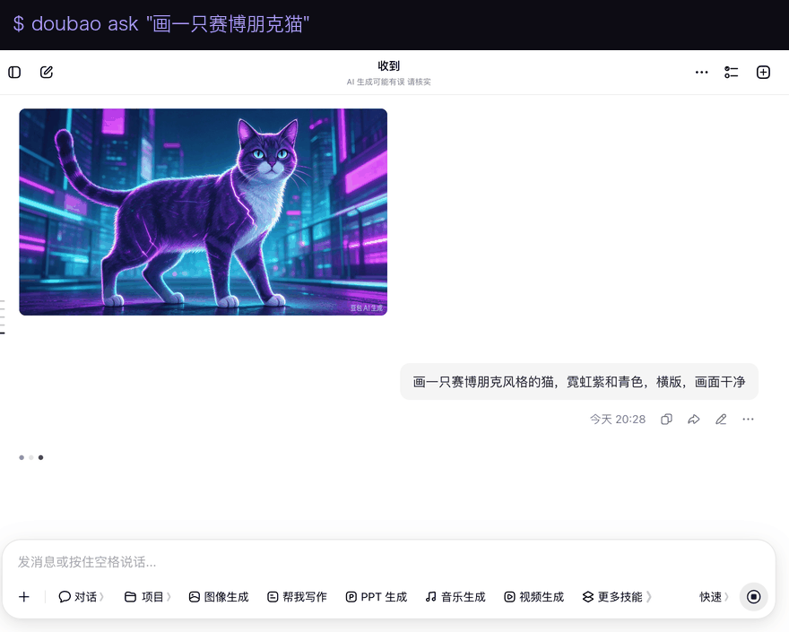

<p align="right"><b>English</b> · <a href="README.md">简体中文</a></p>

<div align="center">


<h2 align="center">Doubao Remote</h2>

<p><b>Drive the local Doubao desktop app from any agent — one-line skill install, zero-config CLI, MCP optional.<br/>豆包遥控器 · 让任意 Agent 驱动本机豆包桌面端</b></p>

[](https://github.com/JimmyWangJimmy/doubao-remote/actions/workflows/ci.yml)
[](docs/SMOKE.md)
[](docs/TOOLS.md)
[](package.json)
[](https://modelcontextprotocol.io)
[](docs/WINDOWS.md)
[](LICENSE)
[](https://glama.ai/mcp/servers/JimmyWangJimmy/doubao-remote)

<p><b>macOS 12+ ✅ supported &nbsp;·&nbsp; Windows 11 ✅ supported &nbsp;·&nbsp; other platforms untested</b></p>

<p><sub>One command — the installer detects your OS first.</sub></p>

</div>

---

## What it is

Turns the Doubao desktop app already installed on your machine into a set of capabilities an agent can call directly:

| Capability | What you can say |
|---|---|
| 💬 Chat | "Ask Doubao…" · "Read its last sentence out loud" |
| 🖼️ Images | "Have Doubao draw…" · "Give me the picture" |
| 🎛️ Control | "Switch to Doubao 2.1 Lite" · "Open the skills panel" · "Go to the workspace" |
| 📎 Attachments | "Hand it this PDF and ask for a summary" |
| 🔌 Shape | a `doubao` CLI (no registration) or MCP (for clients without a shell) |

<p align="center"></p>

<p align="center"><sub>One command → Doubao draws → the image lands on disk. No scripts, no synthetic clicks.</sub></p>

No cloud API key: it drives your own Doubao account and quota.

## Platforms

Both platforms have feature parity; only the entry point differs. Details: [docs/WINDOWS.md](docs/WINDOWS.md).

| Capability | macOS 12+ | Windows 11 | Notes |
|---|---|---|---|
| Chat / read replies | ✅ | ✅ | |
| Image generation / capture | ✅ | ⚠️ untested | Needs a generated image in history; same selectors |
| Model switching (13 models + reasoning effort) | ✅ | ✅ | Windows shows only "Fast / Expert" on an empty chat; open an existing conversation for the full list |
| Skills panel | ✅ | ✅ | |
| Plugins / partners | ✅ | ✅ | Windows has no plugin button in the toolbar; tools read from the "plugins · skills · partners" page instead |
| Sessions / navigation / search / upload / screenshot | ✅ | ✅ | |
| MCP daemon | ✅ launchd | ✅ logon task or Startup folder | Falls back to the Startup folder without admin rights |
| Bundled smoke test | 28/28 | 26/28 + 2 skipped (no sample) | `npm run smoke` |

### Pick your install line

| Platform | Status | One-line install | After install |
|---|---|---|---|
| **macOS 12+** | ✅ supported | `curl -fsSL https://raw.githubusercontent.com/JimmyWangJimmy/doubao-remote/main/install.sh \| bash` | ✅ 28/28 smoke |
| **Windows 11** | ✅ supported | `irm https://raw.githubusercontent.com/JimmyWangJimmy/doubao-remote/main/install.ps1 \| iex` | ✅ 26/28 + 2 skipped (no sample) |

> Both installers detect the platform: `install.sh` under Git Bash hands over to `install.ps1`, and `install.ps1` on a non-Windows host points you back to `install.sh`. **Copying the wrong line does not break anything.**

### Or hand it to your agent

```text
Install and connect Doubao Remote for me: https://github.com/JimmyWangJimmy/doubao-remote
Follow the "Platforms" section of the README, then run doubao status and confirm "ok": true.
After that I'll just say "let Doubao do …" and you drive it. Don't ask me about the internals.
```

The agent picks the installer that matches your OS.

### Install by hand

```bash
# macOS 12+ (terminal)
curl -fsSL https://raw.githubusercontent.com/JimmyWangJimmy/doubao-remote/main/install.sh | bash
# If raw.githubusercontent.com is blocked, the equivalent:
#   git clone https://github.com/JimmyWangJimmy/doubao-remote.git && bash doubao-remote/install.sh

doubao status        # expect "ok": true
doubao ask "Introduce yourself in one sentence"
```

```powershell
# Windows 11 (PowerShell; install Node >= 21 first: winget install OpenJS.NodeJS.LTS)
irm https://raw.githubusercontent.com/JimmyWangJimmy/doubao-remote/main/install.ps1 | iex

doubao status        # expect "ok": true
doubao ask "Introduce yourself in one sentence"
```

> On Windows you can also `git clone` and double-click `install.cmd`, or run `powershell -ExecutionPolicy Bypass -File .\install.ps1`.

Both installers do the same four things: put `doubao` in your user bin directory, launch Doubao with a devtools port, self-check, and print the next step.
It works right away, **no daemon required**. Two optional flags:

| Flag | macOS / Linux | Windows | Effect |
|---|---|---|---|
| Install the agent skill | `--skill` | `-Skill` | Copies the skill to `~/.agents/skills/doubao-desktop` (Windows: `%USERPROFILE%\.agents\skills`) |
| Persistent MCP | `--service` | `-Service` | Keeps `http://127.0.0.1:18812/mcp` online (only needed for heavy or MCP-only hosts); launchd on macOS, logon task / Startup folder on Windows |
| Both | `--all` | `-All` | Equivalent to the two above |

> Windows install details, platform differences and known limitations: [docs/WINDOWS.md](docs/WINDOWS.md).

<details>
<summary>Run from source (developers)</summary>

```bash
git clone https://github.com/JimmyWangJimmy/doubao-remote.git && cd doubao-remote
open -a Doubao --args --remote-debugging-port=9333   # macOS, once; on Windows use `doubao ensure`
node src/server.js                                   # → http://127.0.0.1:18812/mcp
```

> `EADDRINUSE` on 18812 means the MCP server is already running: check with `doubao service status` instead of starting a second one.
</details>

## Client setup

| Your situation | Choose |
|---|---|
| The agent can run shell commands (Claude Code / Cursor / DSH / Codex) | **Skill + CLI only**, no daemon. For heavy tasks the agent runs `doubao service start` itself |
| The host speaks MCP only (no bash) | `bash install.sh --service`, then point the client at `http://127.0.0.1:18812/mcp` |
| Several programs sharing one connection | Same as above; MCP suits long-lived connections and structured arguments |

Per-client config samples: [docs/CLIENTS.md](docs/CLIENTS.md)

## Examples

| Goal | Command |
|---|---|
| Ask something | `doubao ask "Introduce yourself in one sentence"` |
| Generate and fetch an image | `doubao ask "Draw a violet-haired girl, 3:4" 180000` → `doubao images 1` |
| See what it is doing | `doubao screenshot` |
| Switch model / list skills | `doubao set-model "Doubao 2.1 Lite"` · `doubao skills` |
| Find an old conversation | `doubao conversations 20` → `doubao open "intro"` |

## 📚 Docs

| Document | Contents |
|---|---|
| [docs/TOOLS.md](docs/TOOLS.md) | The 23 tools and the CLI cheatsheet |
| [docs/CLIENTS.md](docs/CLIENTS.md) | Client configuration samples |
| [docs/CAPABILITIES.md](docs/CAPABILITIES.md) | 13 models, 30 built-in skills, injected local skills, all test ids |
| [docs/ARCHITECTURE.md](docs/ARCHITECTURE.md) | Module responsibilities and data flow |
| [docs/PITFALLS.md](docs/PITFALLS.md) | 14 implementation pitfalls |
| [docs/SMOKE.md](docs/SMOKE.md) | The 28-case smoke report |
| [docs/WINDOWS.md](docs/WINDOWS.md) | Windows install, differences, measured results, limitations |
| [docs/ROADMAP.md](docs/ROADMAP.md) | What is next and what we will not do |
| [skills/doubao-desktop/SKILL.md](skills/doubao-desktop/SKILL.md) | The agent-facing skill |
| [CONTRIBUTING.md](CONTRIBUTING.md) · [CHANGELOG.md](CHANGELOG.md) | How to change things, what changed |

## License

MIT. For local automation and personal use; Doubao's terms of service and all account/content ownership stay with ByteDance and you.
