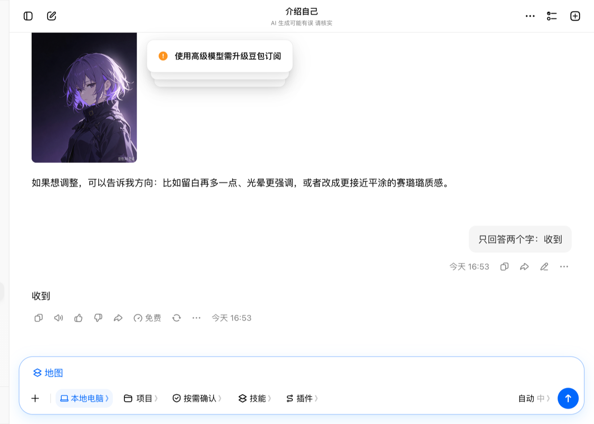
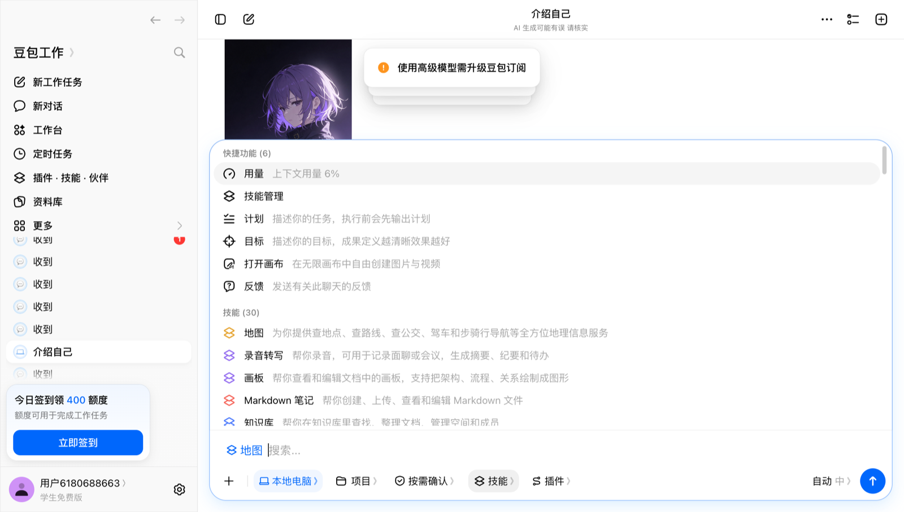

<div align="center">


<h2 align="center">Doubao Desktop MCP</h2>

<p><b>Drive the local Doubao desktop app (豆包.app) from any MCP client —<br/>real UI, zero cloud keys.</b></p>

[](https://github.com/JimmyWangJimmy/doubao-desktop-mcp/actions/workflows/ci.yml)
[](#-冒烟测试28-项)
[](#-工具参考23-个)
[](package.json)
[](https://modelcontextprotocol.io)
[](#-限制)
[](LICENSE)

</div>

## ⚡ 一句话安装

把下面这一整段复制给你的 Agent（Claude Code / Cursor / DSH / 任意支持 MCP 的客户端），剩下的它自己会做完：

```text
帮我安装并接入 doubao-desktop-mcp（https://github.com/JimmyWangJimmy/doubao-desktop-mcp）。
步骤：1) 克隆到 ~/Github/doubao-desktop-mcp；2) 若豆包没带调试端口，执行
open -a Doubao --args --remote-debugging-port=9333，并确认 curl -s 127.0.0.1:9333/json/version 有返回；
3) 在后台跑 node src/server.js（MCP 端点 http://127.0.0.1:18812/mcp，Node >= 21，零依赖）；
4) 把该端点按 streamable-http 注册成名为 doubao-desktop 的 MCP；
5) 用 doubao_desktop_status 验证已连上，不要跳过这步；有问题按 README 的「故障速查」处理。
```

<details>
<summary>不想交给 Agent？人工三步走</summary>

```bash
git clone https://github.com/JimmyWangJimmy/doubao-desktop-mcp.git && cd doubao-desktop-mcp
open -a Doubao --args --remote-debugging-port=9333
node src/server.js        # → http://127.0.0.1:18812/mcp
```
</details>

<div align="center">

把本机安装的豆包桌面端变成一套 MCP 工具：发消息、取回复、拉生成图、切模型、调技能、开会话、截图、上传附件。



</div>

---

## 目录

- [这是什么](#这是什么)
- [一句话安装](#-一句话安装)
- [快速开始](#快速开始)
- [接入客户端](#接入客户端)
- [工具参考（23 个）](#-工具参考23-个)
- [用法示例](#-用法示例)
- [架构](#-架构)
- [能力清单](#-能力清单)
- [冒烟测试（28 项）](#-冒烟测试28-项)
- [故障速查](#-故障速查)
- [限制](#-限制)
- [路线图](#-路线图)
- [参与贡献](#-参与贡献)

---

## 这是什么

```
Agent  ──MCP (HTTP)──▶  doubao-desktop-mcp  ──CDP (WebSocket)──▶  豆包.app 渲染进程
                        127.0.0.1:18812                           127.0.0.1:9333
```

一句话：**给豆包桌面端装一个外置的控制端口**，让 Claude Code / Cursor / DSH 这类 MCP 客户端能像调 API 一样调它。

- 🖥️ **真实 UI**：拿到的是渲染进程的完整 DOM 与输入事件，不是截图 + OCR
- 🧠 **全量能力**：13 个模型、30 个内置技能、本机注入的 67 个 Agent 技能、画布、Office 任务、定时任务、资料库
- 🖼️ **图片直取**：生成图从 `message_image_content` 里落盘，原图 + 缩略图一并带回
- 🪶 **零依赖**：只有一个 Node 文件 + stdlib，`node src/server.js` 就能跑
- 🔁 **可常驻**：附 `launchd` 模板，登录自启、崩溃自拉
- 🧪 **可复跑**：28 项冒烟测试，一条命令验证你的豆包版本还能不能驱动

## 快速开始

```bash
git clone https://github.com/JimmyWangJimmy/doubao-desktop-mcp.git
cd doubao-desktop-mcp

# 1) 带调试端口启动豆包（只需一次，或交给 doubao_desktop_ensure）
open -a Doubao --args --remote-debugging-port=9333

# 2) 起 MCP 服务（Node ≥ 21，零依赖）
node src/server.js
# doubao-desktop-mcp listening on http://127.0.0.1:18812/mcp (tools: 23)

# 3) 验证（会真的往豆包发一条「只回答两个字：收到」）
node scripts/smoke.js
```

> 想常驻：把 `launchd/com.jimmy.doubao-desktop-mcp.plist` 里的 `__REPO__` 换成仓库绝对路径，放进 `~/Library/LaunchAgents/`，然后
> `launchctl bootstrap gui/$(id -u) ~/Library/LaunchAgents/com.jimmy.doubao-desktop-mcp.plist`

## 接入客户端

任何支持 **streamable HTTP** 的 MCP 客户端都能直接连 `http://127.0.0.1:18812/mcp`。

<details>
<summary><b>DSH（DeepSeek Harness）</b></summary>

在 profile 的 `cordis.patch.yml` 里追加：

```yaml
- insert:
    - id: doubao-desktop
      name: "@deepseek-ai/dsh-mcp-client"
      config:
        serverName: doubao-desktop
        transport: streamable-http
        url: http://127.0.0.1:18812/mcp
        failOnStartupError: false
```

保存后热挂载，工具立刻出现在会话里。
</details>

<details>
<summary><b>通用 mcp.json（Claude Code / Cursor / 其他）</b></summary>

```json
{
  "mcpServers": {
    "doubao-desktop": {
      "type": "http",
      "url": "http://127.0.0.1:18812/mcp"
    }
  }
}
```
</details>

## 🧰 工具参考（23 个）

| 分类 | 工具 | 作用 |
|---|---|---|
| **状态** | `doubao_desktop_status` | 进程 / 调试端口 / 当前页 / 输入框状态 |
| | `doubao_desktop_ensure` | 调试端口没开就重启 app（会中断当前输入） |
| | `doubao_desktop_snapshot` | 页面 + 已打开面板的结构化快照 |
| | `doubao_desktop_screenshot` | 截图落盘，返回路径 |
| | `doubao_desktop_eval` | 页面内执行 JS（逃生舱） |
| **输入层** | `doubao_desktop_click` | 真实鼠标点击（selector / testid / 文本） |
| | `doubao_desktop_type` | 向输入框写字 |
| | `doubao_desktop_press` | Enter / Escape / Tab / ⌘A |
| **对话** | `doubao_desktop_ask` | 发送并等到「真回复」（含图片 URL） |
| | `doubao_desktop_replies` | 读最近 N 条回复 |
| | `doubao_desktop_new_chat` | 新对话 |
| | `doubao_desktop_conversations` | 侧栏会话列表 |
| | `doubao_desktop_open_conversation` | 按标题（子串）打开会话 |
| | `doubao_desktop_message_action` | 复制 / 分享 / 重新生成 / 点赞 / 朗读 / 图片下载·引用·进画布 |
| **媒体** | `doubao_desktop_images` | 抓取并下载回复中的图片 |
| **配置** | `doubao_desktop_models` | 枚举模型菜单 |
| | `doubao_desktop_set_model` | 切换模型 |
| | `doubao_desktop_skills` | 技能面板（快捷功能 + 内置技能 + 本机技能） |
| | `doubao_desktop_toggle_skill` | 选择技能 |
| | `doubao_desktop_plugins` | 插件 / 伙伴面板 |
| | `doubao_desktop_upload_file` | 上传附件，可顺带回一句话 |
| **导航** | `doubao_desktop_goto` | 工作台 / 定时任务 / 技能页 / 资料库 / 新工作任务 / 搜索 / 设置 / 对话 |
| | `doubao_desktop_search` | 全局搜索 |

## 💬 用法示例

```
> 让豆包画一张「紫罗兰短发少女」的立绘，画完把图给我
  → doubao_desktop_ask      → 35 秒，返回「已完成图片生成」+ 图 URL
  → doubao_desktop_images   → ~/Pictures/doubao-desktop/img-*.png (1330×1773)

> 豆包现在能切哪些模型？
  → doubao_desktop_models   → 13 个 + 推理强度

> 开个新对话，问它「三个字的自我介绍」
  → doubao_desktop_new_chat → doubao_desktop_ask

> 打开「介绍自己」，把它最后一句读出来
  → doubao_desktop_open_conversation → doubao_desktop_message_action({action:"read_aloud"})

> 看看豆包现在的界面
  → doubao_desktop_screenshot
```

## 🏗 架构

```
src/server.js      MCP 传输层：Streamable HTTP、JSON 回复、工具注册
src/cdp.js         CDP 客户端：Input 事件、截图、文件注入、目标打分选择
src/tools.js       23 个工具实现（含面板文本 diff 读取、hover 重试）
src/selectors.js   实测过的选择器表（豆包改版时只改这里）
scripts/smoke.js   28 项全量冒烟，输出 docs/smoke.json + docs/SMOKE.md
scripts/cdp-*.js   调试三件套：eval / click / probe
skills/            Agent 用 Skill（含故障速查）
```

## 📋 能力清单

实测环境：Doubao.app **2.37.12** · `Chrome/147` · 学生免费版。

| 面 | 内容 |
|---|---|
| 模型 | 自动、豆包 2.1 Lite / Pro、DeepSeek V4.1 Flash / V4 Pro、Qwen 4 Max / 3.8 Max / Flash、Kimi K3.1 Pro（含高速）/ K3、GLM 5.3 / 5.3 Flash + 推理强度 |
| 快捷功能 | 用量（上下文占比）、技能管理、计划、目标、打开画布、反馈 |
| 内置技能 | 30 个：地图、录音转写、画板、Markdown 笔记、知识库、任务、云文档、PPT、会议、多维表格、云盘、表格、AI MediaKit（视频/图像）、HTML、Word、PDF、Seedream 5.5、Seedance 2.5、创意设计/视频、定时任务、创建技能、操作浏览器、操作电脑 … |
| 本机技能 | 「来自本机 (67)」：豆包直接读取 `~/.agents/skills`，与 DSH 技能库一一对应 |
| 消息动作 | 复制、分享、编辑、重新生成、点赞/点踩、朗读（TTS）、图片下载/参考/在画布打开 |
| 导航 | 工作台、定时任务、资料库、技能页、新工作任务、全局搜索、设置、工作区切换 |

<p align="center"></p>


## ✅ 冒烟测试（28 项）

```bash
node scripts/smoke.js      # 输出 docs/SMOKE.md + docs/smoke.json
```

当前：**28/28 通过**。覆盖 状态 → 模型/技能/插件面板 → 会话 → 读图 → 消息动作 → 切模型 → 发消息取回复 → 五个页面导航 → 搜索 → 上传 → 截图 → 点击层 → 工作区/画布。

最新报告：[docs/SMOKE.md](docs/SMOKE.md)

## 🩹 故障速查

| 现象 | 原因 | 处理 |
|---|---|---|
| `element not found: [data-testid=chat_input_action_model]` | 在新对话（draft）页，那里只有「项目 / 更多」 | 先 `open_conversation` 或发一条消息 |
| `no Doubao page target` | app 没带调试端口 | `doubao_desktop_ensure`（会重启豆包） |
| `control not available: read_aloud` | 朗读按钮 hover 才挂载 | 重开会话再试 |
| 面板读到空 | 面板本来就开着，点击把它关了 | 工具已内置 Escape 重试 |
| `timed_out: true` | 生成慢 | **不要重发**，用 `replies` 续读 |
| `使用高级模型需升级豆包订阅` | 账号没有该模型权限 | 换回「自动」或升级订阅 |

14 条完整踩坑记录：[docs/PITFALLS.md](docs/PITFALLS.md) —— 比代码更值钱。

## ⚠️ 限制

- **只支持 macOS**：依赖 `open -a` / `osascript` / `pgrep`。
- **跟着 UI 走**：豆包改版可能让选择器失效，`npm run smoke` 用来定位断点。
- **花的是你的额度**：出图一张约 12.70 点，界面会明写；冒烟历史图抓取不产生费用。
- **图片带水印**：`message_image_content` 的图自带「豆包AI生成」。
- **`ensure` 会重启 app**：未发送的输入会丢。
- **不要并发**：单个 webview 只有一个焦点，工具调用请串行。

## 🗺 路线图

- [x] 对话 / 读回复 / 出图 / 切模型 / 技能 / 插件 / 导航 / 上传 / 截图
- [x] 28 项冒烟 + 全量能力清单
- [ ] 工作台 / 定时任务 / 资料库的逐条 CRUD（目前只到「导航并读页面」）
- [ ] 画布（无限画布）节点级操作
- [ ] 会话清理 / 归档 / 重命名的批量接口
- [ ] Windows 版（换掉 `osascript`，改用 PowerShell + `--remote-debugging-port`）
- [ ] 把「操作电脑 / 操作浏览器」技能纳入 MCP 语义层

## 🤝 参与贡献

1. Fork → 开分支 → 改 `src/selectors.js` 或 `src/tools.js`
2. `npm run smoke` 必须仍是全绿（或明确说明哪条因为版本差异预期失败）
3. 提 PR 时带上 `docs/smoke.json` 的前后对比

Issue 模板已备好：`.github/ISSUE_TEMPLATE/`。

## 许可

MIT。仅供本机自动化与自用；豆包的服务条款、账号与内容归属仍归字节跳动与你本人。
