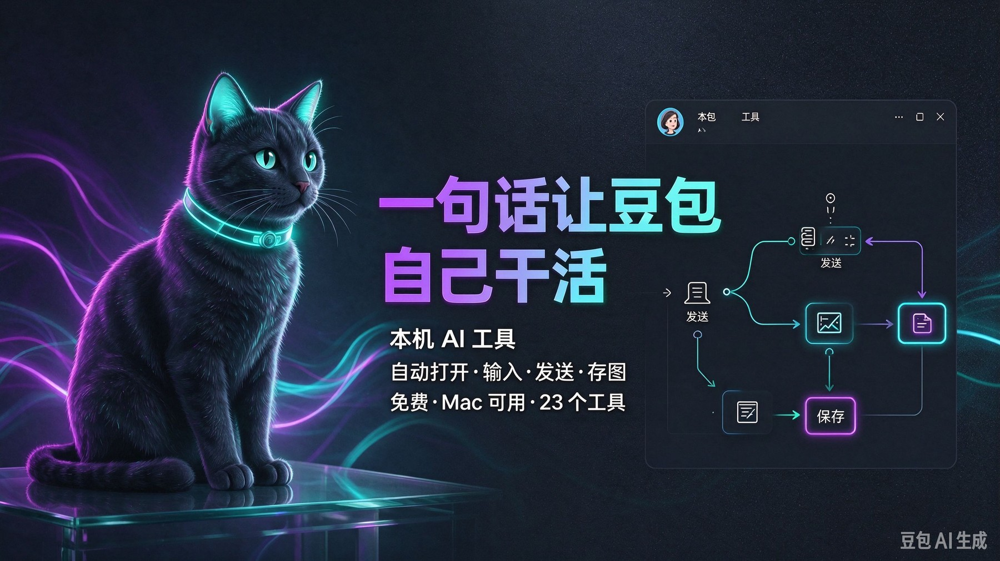

<div align="center">


<h2 align="center">豆包遥控器 · Doubao Remote</h2>

<p><b>让任意 Agent 驱动本机豆包桌面端 —— Skill 一句话装，CLI 零注册，MCP 可选。<br/>Drive the local Doubao desktop app (豆包.app) from any agent.</b></p>

[](https://github.com/JimmyWangJimmy/doubao-remote/actions/workflows/ci.yml)
[](docs/SMOKE.md)
[](docs/TOOLS.md)
[](package.json)
[](https://modelcontextprotocol.io)
[](docs/ROADMAP.md)
[](LICENSE)
[](https://glama.ai/mcp/servers/JimmyWangJimmy/doubao-remote)

<p><b>macOS 12+ ✅ 已支持 &nbsp;·&nbsp; Windows 🚧 开发中</b></p>

</div>

---

<p align="center"></p>

## 这是什么

把本机安装的豆包桌面端，变成 Agent 能直接调用的一组能力：

| 能力 | 你能说的话 |
|---|---|
| 💬 对话 | 「问豆包一句……」「把它最后一句读出来」 |
| 🖼️ 出图 | 「让豆包画一张……」「把图给我」 |
| 🎛️ 控制 | 「切到豆包 2.1 Lite」「打开技能面板」「去工作台」 |
| 📎 附件 | 「把这份 PDF 丢给它，让它总结」 |
| 🔌 形态 | `doubao` 命令（零注册）或 MCP（给没有 shell 的客户端） |

<p align="center"></p>

<p align="center"><sub>一句命令 → 豆包自己画 → 图落盘。没有脚本、没有模拟点击。</sub></p>

不需要云端 API key，跑的是你自己的豆包账号与额度。

## 开始

### 交给 Agent（推荐）

```text
帮我装好「豆包遥控器」并接上：https://github.com/JimmyWangJimmy/doubao-remote
按 README 的「开始」装，跑 doubao status 确认 "ok": true，之后我用「让豆包去做…」直接使唤它。细节不用问我。
```

### 自己手动两条

```bash
curl -fsSL https://raw.githubusercontent.com/JimmyWangJimmy/doubao-remote/main/install.sh | bash
# 国内 raw 偶尔被重置，等价命令：
#   git clone https://github.com/JimmyWangJimmy/doubao-remote.git && bash doubao-remote/install.sh

doubao status        # 期望 "ok": true
doubao ask "用一句话介绍你自己"
```

安装器做四件事：装 `doubao` 到 `~/.local/bin`、带调试端口拉起豆包、自检、打印下一步。
装完即可用，**不需要开启任何服务**。两个可选开关：

| 参数 | 作用 |
|---|---|
| `--skill` | 把技能装进 Agent 目录（`~/.agents/skills/doubao-desktop`） |
| `--service` | launchd 常驻，MCP 端点 `http://127.0.0.1:18812/mcp` 长期在线（复杂任务或纯 MCP 宿主才需要） |

<details>
<summary>从源码跑（开发者 / 想改代码）</summary>

```bash
git clone https://github.com/JimmyWangJimmy/doubao-remote.git && cd doubao-remote
open -a Doubao --args --remote-debugging-port=9333   # 只需一次
node src/server.js                                   # → http://127.0.0.1:18812/mcp
```

> 18812 已占用（`EADDRINUSE`）说明 MCP 已在跑：`doubao service status` 确认即可，别再起第二个。
</details>

## 接入客户端

| 你的情况 | 选哪条 |
|---|---|
| Agent 能跑 shell（Claude Code / Cursor / DSH / Codex） | **只装 Skill + CLI**，不开服务。复杂任务 Agent 自己 `doubao service start` |
| 宿主只能走 MCP（没有 bash） | `bash install.sh --service`，把 `http://127.0.0.1:18812/mcp` 填进客户端 |
| 要给别人 / 别的程序复用同一连接 | 同上，MCP 更适合长连接与结构化参数 |

各客户端配置样例：[docs/CLIENTS.md](docs/CLIENTS.md)

## 用法示例

| 想做的事 | 跑这条 |
|---|---|
| 问一句 | `doubao ask "用一句话介绍你自己"` |
| 出图并取回 | `doubao ask "画一张紫罗兰短发少女立绘，3:4" 180000` → `doubao images 1` |
| 看它现在在干什么 | `doubao screenshot` |
| 换模型 / 看技能 | `doubao set-model "豆包 2.1 Lite"` · `doubao skills` |
| 找历史对话 | `doubao conversations 20` → `doubao open "介绍自己"` |

## 📚 文档

| 文档 | 内容 |
|---|---|
| [docs/TOOLS.md](docs/TOOLS.md) | 23 个工具清单 + CLI 速查 |
| [docs/CLIENTS.md](docs/CLIENTS.md) | 各客户端配置样例 |
| [docs/CAPABILITIES.md](docs/CAPABILITIES.md) | 13 个模型、30 个内置技能、本机技能注入、全部 testid |
| [docs/ARCHITECTURE.md](docs/ARCHITECTURE.md) | 模块职责与数据流 |
| [docs/PITFALLS.md](docs/PITFALLS.md) | 14 条踩坑 |
| [docs/SMOKE.md](docs/SMOKE.md) | 28 项冒烟报告 |
| [docs/ROADMAP.md](docs/ROADMAP.md) | 待办与不做的事 |
| [skills/doubao-desktop/SKILL.md](skills/doubao-desktop/SKILL.md) | Agent 用的 Skill |
| [docs/LAUNCH.md](docs/LAUNCH.md) | 推广手册：渠道矩阵、可直接复制的文案、目录提交清单 |
| [CONTRIBUTING.md](CONTRIBUTING.md) · [CHANGELOG.md](CHANGELOG.md) | 怎么改、改了什么 |

## 许可

MIT。仅供本机自动化与自用；豆包的服务条款、账号与内容归属仍归字节跳动与你本人。
